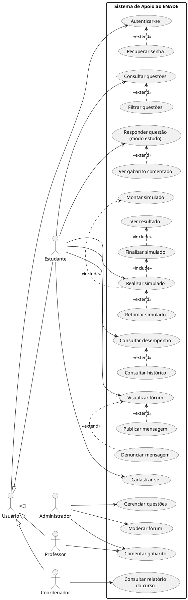
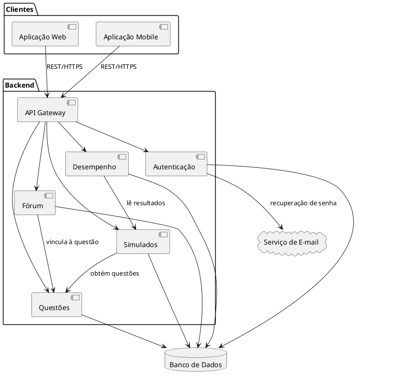
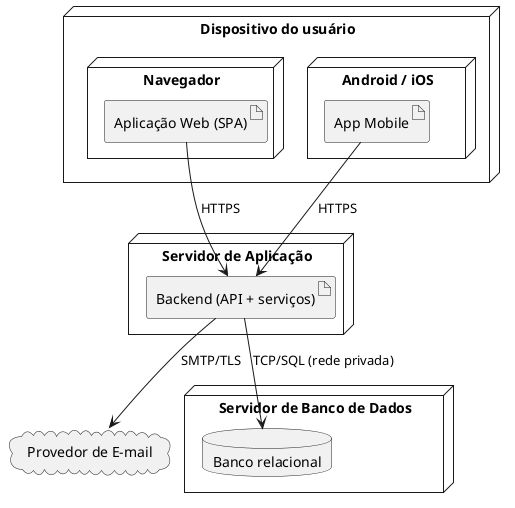

# Sistema de Apoio ao ENADE
## Elicitação de Requisitos e Modelagem Inicial

**Disciplina:** Requisitos e Modelagem de Sistemas
**Atividade:** Trabalho P1 — Sprint 1 / Milestone M1
**Período:** 20/10/2026 a 02/11/2026

---

## 1. Documento de Visão

### 1.1 Introdução

O ENADE (Exame Nacional de Desempenho dos Estudantes) é componente curricular obrigatório dos cursos de graduação e um dos indicadores usados pelo MEC para avaliar a qualidade do ensino superior. Apesar disso, boa parte dos estudantes chega à prova sem ter tido contato com o formato das questões, sem ter feito uma prova completa dentro do tempo e sem saber em quais conteúdos tem mais dificuldade.

Este projeto especifica um sistema web e mobile para apoiar essa preparação, reunindo em um só lugar questões de edições anteriores, simulados cronometrados, gabaritos comentados, acompanhamento de desempenho e discussão entre estudantes.

### 1.2 Contexto: estrutura da prova

A especificação considera a estrutura usual do ENADE:

| Componente | Questões objetivas | Questões discursivas | Total |
|---|---:|---:|---:|
| Formação Geral | 8 | 2 | 10 |
| Componente Específico (por curso) | 27 | 3 | 30 |
| **Total** | **35** | **5** | **40** |

A prova tem duração de 4 horas. Questões podem ser anuladas pelo INEP após a aplicação, o que precisa ser tratado pelo sistema.

### 1.3 Problema

Hoje o estudante que quer se preparar precisa procurar provas antigas em PDF no site do INEP, conferir gabaritos em documentos separados e não tem como saber, de forma organizada, em que áreas está errando mais. Não existe um ambiente que junte questões, explicação das respostas, prática em condição de prova e acompanhamento da evolução.

### 1.4 Objetivo do sistema

Oferecer ao estudante de graduação um ambiente de estudo para o ENADE em que ele possa praticar questões de edições anteriores, simular a prova no tempo real, entender seus erros e acompanhar seu desempenho por área de conhecimento.

### 1.5 Objetivos específicos

- Disponibilizar um banco de questões de edições anteriores, classificado por ano, curso, componente (formação geral ou específico) e área de conhecimento.
- Permitir simulados cronometrados, completos ou parciais.
- Apresentar gabarito comentado para questões objetivas e padrão de resposta para questões discursivas.
- Mostrar o desempenho do estudante por área e ao longo do tempo.
- Oferecer um espaço de discussão por questão.
- Garantir acesso individual e proteção dos dados pessoais.

### 1.6 Público-alvo

- **Estudantes de graduação** que farão o ENADE: usuários principais.
- **Professores:** podem contribuir com comentários de questões e usar o sistema como apoio em aula.
- **Coordenações de curso:** interessadas em acompanhar, de forma agregada, o nível de preparação das turmas.

### 1.7 Escopo

| Módulo | Descrição |
|---|---|
| Banco de questões | Consulta e filtro de questões por ano, curso, componente e área |
| Modo estudo | Resolução de questões avulsas com correção imediata |
| Simulados | Prova cronometrada, completa ou parcial, com correção ao final |
| Gabarito comentado | Explicação da resposta correta e padrão de resposta das discursivas |
| Desempenho | Estatísticas por área, gráficos e histórico |
| Fórum | Discussão vinculada a cada questão, com moderação |
| Acesso | Cadastro, autenticação e recuperação de senha |
| Administração | Gestão do banco de questões e moderação |

### 1.8 Fora do escopo

- Implementação do sistema (esta etapa é de especificação).
- Correção automática de questões discursivas.
- Produção de conteúdo inédito (o banco se limita a questões de edições anteriores).
- Integração com sistemas acadêmicos da universidade.

---

## 2. Stakeholders

| Stakeholder | Interesse | Influência | Papel |
|---|---|:---:|---|
| Estudante | Praticar, simular a prova e acompanhar a evolução | Alta | Usuário principal |
| Administrador | Manter o banco de questões e moderar o fórum | Alta | Usuário administrativo |
| Professor | Comentar questões e usar o sistema em aula | Média | Usuário colaborador (a validar) |
| Coordenação de curso | Acompanhar a preparação das turmas | Média/Alta | Consumidor de relatórios (a validar) |
| Universidade | Melhorar o desempenho institucional no ENADE | Alta | Patrocinador |
| Equipe de desenvolvimento | Especificar e implementar a solução | Média | Equipe técnica |
| Professor da disciplina | Avaliar e validar os entregáveis | Alta | Validador |

A elicitação começa pelos estudantes, que usarão a maior parte das funcionalidades. Professores e coordenadores serão consultados para validar as necessidades pedagógicas e definir até onde vai o acesso a dados de desempenho dos alunos.

---

## 3. Técnicas de Elicitação

| Técnica | Objetivo | Público |
|---|---|---|
| Entrevista semiestruturada | Entender hábitos de estudo, dificuldades e expectativas | Estudantes, professores, coordenação |
| Questionário online | Confirmar com mais pessoas as necessidades levantadas nas entrevistas | Estudantes de diferentes cursos |
| Análise documental | Entender a estrutura da prova e os critérios de classificação das questões | Provas, gabaritos e relatórios do INEP |
| Análise de sistemas similares | Identificar funcionalidades esperadas e pontos fracos | QConcursos, Estuda.com |

---

## 4. Roteiros de Entrevista

### 4.1 Estudantes

1. Você já usou alguma plataforma para estudar para provas ou concursos? Qual? O que gostou e o que não gostou?
2. Se fosse estudar para o ENADE hoje, onde procuraria questões antigas?
3. Qual é a sua maior dificuldade para se preparar?
4. Que filtros seriam úteis para encontrar questões (ano, curso, área, dificuldade)?
5. Você faria uma prova completa de 4 horas no sistema, ou preferiria simulados menores?
6. Depois de responder uma questão, o que gostaria de ver?
7. Como lida com as questões discursivas? Gostaria de ver um padrão de resposta para comparar?
8. Que informações sobre seu desempenho seriam mais úteis?
9. Você participaria de discussões sobre as questões?
10. Se a conexão cair no meio de um simulado, o que você espera que aconteça?
11. Você se incomodaria se a coordenação visse seus resultados? E se fossem dados agregados da turma?
12. O que faria você voltar a usar a plataforma com frequência?

### 4.2 Professores e coordenação

1. Quais são as principais dificuldades dos alunos no ENADE?
2. Como é feita a preparação hoje no curso?
3. Que informações ajudariam a avaliar o nível de preparação da turma?
4. Como as questões deveriam ser classificadas por área?
5. Você estaria disposto a escrever comentários de questões?
6. Que cuidados o sistema deve ter com os dados dos alunos?
7. Qual funcionalidade deveria ser prioridade?

---

## 5. Resultados das Entrevistas

> Preencher com as respostas obtidas. Cada achado deve indicar o requisito que ele gera ou confirma.

| ID | Perfil / Curso | Necessidade identificada | Problema relatado | Requisito relacionado |
|---|---|---|---|---|
| E01 | Estudante — | | | |
| E02 | Estudante — | | | |
| E03 | Estudante — | | | |
| E04 | Professor — | | | |
| E05 | Coordenador — | | | |

### Necessidades levantadas na análise documental

| ID | Necessidade |
|---|---|
| N01 | Encontrar questões anteriores organizadas e fáceis de filtrar |
| N02 | Praticar em condição parecida com a da prova real (tempo e quantidade) |
| N03 | Entender por que errou cada questão |
| N04 | Saber em quais áreas precisa estudar mais |
| N05 | Tirar dúvidas e discutir questões com outras pessoas |
| N06 | Ter os próprios dados protegidos e acessíveis só para si |

---

## 6. Requisitos Funcionais

### Acesso

**RF01 — Cadastro de estudante**
O sistema deve permitir que o estudante crie uma conta informando nome, e-mail, senha e curso.
Prioridade: Alta

**RF02 — Autenticação**
O sistema deve permitir que o usuário entre com e-mail e senha e encerre a sessão quando quiser.
Prioridade: Alta

**RF03 — Recuperação de senha**
O sistema deve permitir que o usuário redefina a senha por meio de um link enviado ao e-mail cadastrado.
Prioridade: Alta

### Banco de questões e modo estudo

**RF04 — Consulta e filtro de questões**
O sistema deve permitir consultar questões filtrando por ano, curso, componente (formação geral ou específico), área de conhecimento e tipo (objetiva ou discursiva).
Prioridade: Alta

**RF05 — Visualização de questão**
O sistema deve exibir o enunciado completo da questão, incluindo textos de apoio, imagens e tabelas, e as alternativas, quando houver.
Prioridade: Alta

**RF06 — Resposta de questão objetiva**
No modo estudo, o estudante deve poder marcar uma alternativa e confirmar a resposta, recebendo a indicação de acerto ou erro.
Prioridade: Alta

**RF07 — Resposta de questão discursiva**
O estudante deve poder escrever sua resposta em campo de texto e, depois de confirmar, ver o padrão de resposta divulgado pelo INEP para fazer a autoavaliação.
Prioridade: Média

**RF08 — Gabarito comentado**
Depois que o estudante responde, o sistema deve mostrar a alternativa correta e um comentário explicando por que ela está certa e por que as outras estão erradas.
Prioridade: Alta

### Simulados

**RF09 — Montagem de simulado**
O estudante deve poder escolher entre uma prova completa (40 questões, 4 horas) ou um simulado parcial, definindo componente, área e quantidade de questões.
Prioridade: Alta

**RF10 — Cronômetro**
Durante o simulado, o sistema deve exibir o tempo restante o tempo todo.
Prioridade: Alta

**RF11 — Navegação no simulado**
O estudante deve poder avançar, voltar, deixar questões em branco e alterar respostas enquanto o simulado estiver em andamento.
Prioridade: Alta

**RF12 — Finalização do simulado**
O simulado deve ser finalizado quando o estudante confirmar a entrega ou quando o tempo acabar, o que ocorrer primeiro.
Prioridade: Alta

**RF13 — Retomada de simulado**
Se o estudante sair ou perder a conexão, o sistema deve permitir retomar o simulado de onde parou, com as respostas já marcadas.
Prioridade: Média (a validar)

**RF14 — Resultado do simulado**
Após a finalização, o sistema deve mostrar acertos, erros, questões em branco, tempo utilizado e o gabarito comentado de cada questão.
Prioridade: Alta

### Desempenho

**RF15 — Painel de desempenho**
O sistema deve mostrar o percentual de acertos do estudante, no geral e por área de conhecimento, com gráficos.
Prioridade: Alta

**RF16 — Histórico**
O sistema deve mostrar o histórico de simulados realizados e a evolução do percentual de acertos ao longo do tempo.
Prioridade: Média

### Fórum

**RF17 — Fórum por questão**
Cada questão deve ter um espaço de discussão em que usuários autenticados podem ler e publicar mensagens.
Prioridade: Média

**RF18 — Denúncia e moderação**
Usuários devem poder denunciar mensagens impróprias, e o administrador deve poder ocultar ou remover mensagens.
Prioridade: Média

### Administração

**RF19 — Gestão do banco de questões**
O administrador deve poder cadastrar, editar, classificar e remover questões, além de marcar questões anuladas pelo INEP.
Prioridade: Alta

**RF20 — Cadastro de comentários de gabarito**
Administradores, e professores autorizados, devem poder cadastrar e editar os comentários das questões.
Prioridade: Alta (participação de professores a validar)

**RF21 — Relatório agregado por curso**
A coordenação deve poder consultar o desempenho médio dos estudantes do curso por área, sem identificação individual.
Prioridade: Baixa (a validar)

---

## 7. Requisitos Não Funcionais

| ID | Categoria | Requisito | Como verificar |
|---|---|---|---|
| RNF01 | Usabilidade | Um novo usuário deve conseguir iniciar um simulado em até 3 cliques a partir da tela inicial | Teste com usuários |
| RNF02 | Responsividade | A interface deve funcionar em telas a partir de 360 px de largura | Teste em dispositivos e emuladores |
| RNF03 | Segurança | Senhas devem ser armazenadas com hash (bcrypt ou Argon2), e toda comunicação deve usar HTTPS | Revisão de código e configuração |
| RNF04 | Privacidade | O tratamento de dados pessoais deve seguir a LGPD; os resultados individuais só são visíveis para o próprio estudante | Revisão de regras de acesso |
| RNF05 | Desempenho | 95% das requisições devem responder em até 2 segundos com até 500 usuários simultâneos | Teste de carga |
| RNF06 | Disponibilidade | Disponibilidade mínima de 99% ao mês, com manutenções fora do horário das 8h às 23h | Monitoramento |
| RNF07 | Confiabilidade | As respostas de um simulado em andamento devem ser salvas a cada alteração, sem perda em caso de queda de conexão | Teste de falha de rede |
| RNF08 | Compatibilidade | A versão web deve funcionar nas duas últimas versões de Chrome, Firefox, Edge e Safari; o app, em Android 10+ e iOS 15+ | Teste de compatibilidade |
| RNF09 | Acessibilidade | A interface deve atender ao nível AA da WCAG 2.1 | Ferramenta de auditoria e revisão manual |
| RNF10 | Manutenibilidade | O cadastro de uma nova edição da prova não deve exigir alteração de código | Teste do fluxo de importação |

---

## 8. Regras de Negócio

| ID | Regra |
|---|---|
| RN01 | Apenas usuários autenticados podem responder questões, fazer simulados, ver desempenho e publicar no fórum. A consulta de questões pode ser feita sem login. |
| RN02 | Toda questão deve ter ano, curso, componente, área de conhecimento, tipo e gabarito oficial. |
| RN03 | Questões anuladas pelo INEP continuam visíveis para estudo, mas não entram em simulados nem no cálculo de desempenho. |
| RN04 | No simulado, o gabarito só é exibido depois da finalização. |
| RN05 | O tempo do simulado continua correndo mesmo se o estudante sair da tela. Ao zerar, o simulado é finalizado automaticamente com as respostas já marcadas. |
| RN06 | O tempo da prova completa é de 4 horas. No simulado parcial, o tempo é proporcional: 6 minutos por questão. |
| RN07 | Depois de finalizado, um simulado não pode ter as respostas alteradas. O estudante pode fazer um novo simulado. |
| RN08 | Percentual de acertos = questões objetivas corretas ÷ questões objetivas respondidas. Questões em branco aparecem à parte, e discursivas não entram no cálculo. |
| RN09 | O desempenho por área considera a área de conhecimento cadastrada em cada questão. |
| RN10 | Toda mensagem do fórum fica vinculada a uma questão e ao autor. Mensagens com 3 ou mais denúncias ficam ocultas até a análise do administrador. |
| RN11 | Apenas administradores podem cadastrar, editar ou remover questões. Professores só podem editar comentários de gabarito. |
| RN12 | Relatórios para a coordenação só mostram dados agregados de grupos com pelo menos 5 estudantes. |

---

## 9. Backlog Priorizado

**P1:** essencial para o MVP · **P2:** importante · **P3:** evolução

| ID | História | Prioridade | RF |
|---|---|:---:|---|
| US01 | Como estudante, quero criar minha conta para salvar meu progresso | P1 | RF01 |
| US02 | Como usuário, quero entrar e sair da minha conta | P1 | RF02 |
| US03 | Como usuário, quero recuperar minha senha quando esquecê-la | P1 | RF03 |
| US04 | Como estudante, quero filtrar questões por curso e área para estudar o que preciso | P1 | RF04, RF05 |
| US05 | Como estudante, quero responder uma questão e saber na hora se acertei | P1 | RF06 |
| US06 | Como estudante, quero ler o comentário da questão para entender meu erro | P1 | RF08 |
| US07 | Como estudante, quero fazer um simulado cronometrado para treinar no tempo da prova | P1 | RF09, RF10, RF11, RF12 |
| US08 | Como estudante, quero ver o resultado do simulado com a correção | P1 | RF14 |
| US09 | Como estudante, quero ver meu desempenho por área para saber o que revisar | P1 | RF15 |
| US10 | Como administrador, quero cadastrar e classificar questões para alimentar o banco | P1 | RF19 |
| US11 | Como administrador, quero cadastrar comentários das questões | P1 | RF20 |
| US12 | Como estudante, quero retomar um simulado interrompido | P2 | RF13 |
| US13 | Como estudante, quero ver a evolução das minhas notas | P2 | RF16 |
| US14 | Como estudante, quero discutir uma questão com outros estudantes | P2 | RF17 |
| US15 | Como administrador, quero moderar mensagens denunciadas | P2 | RF18 |
| US16 | Como estudante, quero responder discursivas e comparar com o padrão de resposta | P2 | RF07 |
| US17 | Como coordenador, quero ver o desempenho médio do curso por área | P3 | RF21 |

### 9.1 Critérios de aceitação (histórias P1)

**US01 — Criar conta**
- Dado que informei nome, e-mail válido, senha com pelo menos 8 caracteres e curso, quando confirmo o cadastro, então a conta é criada e eu entro no sistema.
- Dado que o e-mail já está cadastrado, quando tento me cadastrar, então vejo a mensagem "E-mail já cadastrado" e a conta não é criada.

**US02 — Entrar e sair**
- Dado que informei e-mail e senha corretos, quando clico em Entrar, então acesso a tela inicial.
- Dado que errei a senha, quando clico em Entrar, então vejo uma mensagem de erro que não diz qual dos dois campos está errado.

**US03 — Recuperar senha**
- Dado que informei um e-mail cadastrado, quando solicito a recuperação, então recebo um link válido por 1 hora.
- Dado que o link expirou, quando tento usá-lo, então sou orientado a pedir um novo.

**US04 — Filtrar questões**
- Dado que selecionei curso e área, quando aplico o filtro, então só aparecem questões que atendem aos dois critérios.
- Dado que nenhuma questão atende ao filtro, então vejo a mensagem "Nenhuma questão encontrada".

**US05 — Responder questão**
- Dado que marquei uma alternativa, quando confirmo, então vejo se acertei e qual é a alternativa correta.
- Dado que não marquei nenhuma alternativa, então o botão Confirmar fica desabilitado.

**US06 — Ler comentário**
- Dado que respondi a questão, então o comentário aparece abaixo da correção.
- Dado que a questão ainda não tem comentário, então vejo "Comentário em elaboração" e o link para o fórum.

**US07 — Simulado cronometrado**
- Dado que escolhi a prova completa, quando inicio, então o cronômetro começa em 4h00 e aparecem 40 questões.
- Dado que o tempo zerou, então o simulado é finalizado automaticamente e sou levado ao resultado.
- Dado que estou no meio do simulado, então não consigo ver o gabarito de nenhuma questão.

**US08 — Resultado do simulado**
- Dado que finalizei o simulado, então vejo acertos, erros, questões em branco e tempo utilizado.
- Dado que estou no resultado, quando clico em uma questão, então vejo minha resposta, o gabarito e o comentário.

**US09 — Desempenho por área**
- Dado que respondi questões de pelo menos uma área, então vejo meu percentual de acertos por área em um gráfico.
- Dado que ainda não respondi nenhuma questão, então vejo um convite para começar a estudar.

**US10 — Cadastrar questões**
- Dado que sou administrador, quando cadastro uma questão sem área ou sem gabarito, então o sistema não permite salvar.
- Dado que marquei uma questão como anulada, então ela deixa de aparecer em novos simulados.

**US11 — Cadastrar comentários**
- Dado que sou administrador, quando salvo um comentário, então ele passa a aparecer para os estudantes após a resposta.

### 9.2 Critério de priorização

Ficaram como P1 as funcionalidades sem as quais o sistema não cumpre seu objetivo principal: acesso, banco de questões, correção comentada, simulado e desempenho por área. A gestão de questões e de comentários também entrou como P1, porque sem ela o banco não tem conteúdo. Fórum, histórico e discursivas agregam valor, mas o estudante já consegue se preparar sem eles. O relatório para a coordenação ficou como P3 porque depende de uma decisão sobre privacidade que ainda precisa ser validada.

---

## 10. Diagrama de Casos de Uso

**Observações sobre o modelo**

- O ator **Usuário** generaliza os demais, e por isso "Autenticar-se" fica ligado a ele uma única vez.
- **Ver gabarito comentado** estende **Responder questão** apenas no modo estudo. No simulado, a correção aparece dentro de **Ver resultado**, depois da finalização (RN04).
- O controle de tempo não aparece como caso de uso, porque é um comportamento do sistema e não um objetivo do ator. Ele está descrito em RF10, RF12, RN05 e RN06.
- Os atores **Professor** e **Coordenador** e os casos UC20 e UC21 dependem de validação nas entrevistas.

---

## 11. Diagrama de Componentes

| Componente | Responsabilidade |
|---|---|
| Aplicação Web / Mobile | Interface com o usuário |
| API Gateway | Ponto único de entrada, roteamento e validação do token de acesso |
| Autenticação | Cadastro, login, recuperação de senha e perfis de acesso |
| Questões | Banco de questões, filtros, gabaritos e comentários |
| Simulados | Montagem, cronômetro, salvamento automático e correção |
| Desempenho | Cálculo de estatísticas e histórico |
| Fórum | Mensagens, denúncias e moderação |
| Serviço de E-mail | Serviço externo para envio de e-mails transacionais |
| Banco de Dados | Persistência de todos os dados |

---

## 12. Diagrama de Implantação

O cliente (web ou mobile) se comunica com o servidor de aplicação somente por HTTPS. O banco de dados fica em rede privada, acessível apenas pelo servidor de aplicação. O envio de e-mails é feito por um provedor externo. Tecnologias e hospedagem serão definidas nas próximas etapas.

---

## 13. Matriz de Rastreabilidade

| Necessidade | Requisitos | Histórias | Casos de uso |
|---|---|---|---|
| N01 — Encontrar questões organizadas | RF04, RF05, RF19 | US04, US10 | UC04, UC05, UC18 |
| N02 — Praticar em condição de prova | RF09–RF14 | US07, US08, US12 | UC08–UC12 |
| N03 — Entender os erros | RF06, RF07, RF08, RF20 | US05, US06, US11, US16 | UC06, UC07, UC20 |
| N04 — Saber o que estudar | RF15, RF16, RF21 | US09, US13, US17 | UC13, UC14, UC21 |
| N05 — Discutir questões | RF17, RF18 | US14, US15 | UC15–UC17, UC19 |
| N06 — Dados protegidos | RF01–RF03, RNF03, RNF04 | US01–US03 | UC01–UC03 |

---

## 14. Conclusão

Esta primeira etapa definiu o problema, os envolvidos, o escopo e um conjunto inicial de requisitos, regras e modelos para o Sistema de Apoio ao ENADE. Considerar desde o início a estrutura real da prova (questões discursivas, tempo de 4 horas e questões anuladas) evitou um modelo que tratasse todas as questões como objetivas.

Os pontos marcados como "a validar" (participação de professores, relatório da coordenação e retomada de simulado) serão confirmados ou descartados com base nas entrevistas, cujos resultados vão atualizar a seção 5 e a matriz de rastreabilidade.
